# Panadería La Espiga

Sitio web para una panadería de barrio, hecho con HTML y CSS.

## 1. El proyecto

### El negocio

La Espiga es una panadería de barrio. Sin embargo, los clientes preguntan una y otra vez por precios y horarios, y en las horas de más movimiento no alcanzan a responder todos los mensajes, así que se pierden pedidos.

### Para quién es el sitio

- *Vecinos del barrio*
- *Personas que encargan con anticipación*
- *Clientes nuevos*

### Qué necesita el cliente

1. Mostrar sus productos con fotos y precios, incluidas las promociones.
2. Publicar horarios y explicar cómo hacer un pedido.
3. Generar confianza con opiniones de clientes.
4. Indicar cómo llegar.
5. Recibir pedidos por un formulario, para no depender de responder cada mensaje.

### Páginas

- `index.html` Presentación, productos en tarjetas, horarios y pasos para pedir, opiniones, cómo llegar (mapa)
- `pedidos.html`  Tabla de precios por cantidad y formulario de pedido
- `gracias.html`  Confirmación que se muestra al enviar el formulario

Las tres comparten el mismo encabezado, la misma navegación y el mismo pie de página.

### Boceto

Boceto hecho a mano de la distribución en escritorio. En celular, las mismas secciones se apilan en una sola columna.

**index.html**

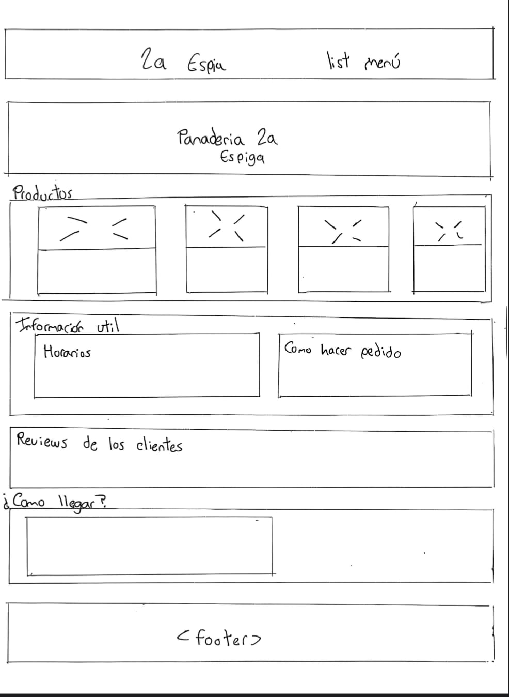

**pedidos.html y gracias.html**

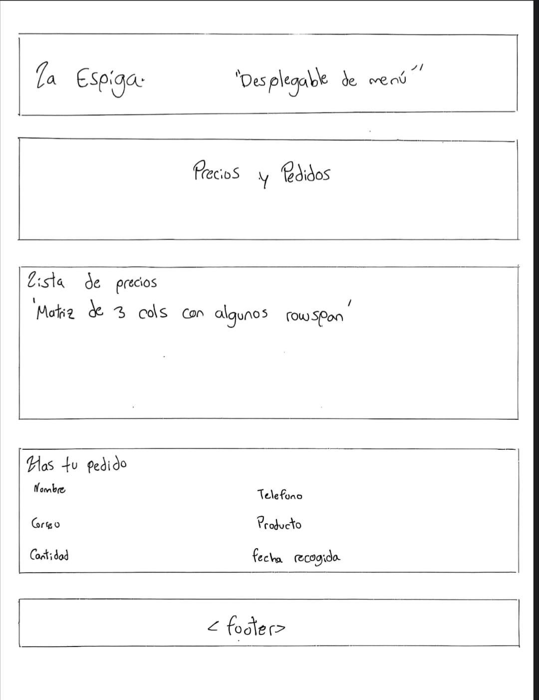

## 2. Estructura

```
panaderia-la-espiga/
 ── index.html
 ── pedidos.html
 ── gracias.html
 ── README.md
 ── css/styles.css
 ── images/      ← fotos guardadas en el proyecto
 ── capturas/    ← bocetos, capturas del sitio y del inspector
```

Para definir "cómo llegar" se uso un mapa con `iframe`.

Sobre las etiquetas que usé:

- El menú está dentro de `header` y `nav`, y los enlaces van en una `ul` porque al final es una lista de enlaces.
- En `main` cada bloque es una `section` con su `h2` y un `id`, así funcionan las anclas como `index.html#productos`. Cada página tiene un solo `h1`.
- Cada producto es un `article`, porque la tarjeta tiene sentido sola aunque la saque de la página.
- El "¿Sabías que…?" lo puse en un `aside` porque es un dato extra, no hace parte de los horarios.
- Las opiniones van con `blockquote` para la cita y `cite` para el nombre de quien la dijo.
- La tabla de precios usa `rowspan` para agrupar los productos por categoría y `colspan` para el encabezado "Precio por cantidad".
- En el formulario cada `label` tiene un `for` igual al `id` de su campo, y en el pie los datos de contacto van en `address`.

El formulario envía a `gracias.html` con `method="get"`, porque el sitio es estático y no hay servidor que reciba un POST. La desventaja es que los datos quedan en la URL.

## 3. Sistema visual

Todas las variables están en `:root` al inicio de `styles.css`. Quería que se sintiera como una panadería, así que saqué los colores del pan:

```css
--color-fondo: #fff8ee;            /* crema */
--color-texto: #3e2a1e;            /* cafe oscuro */
--color-primario: #c8892b;         /* trigo*/
--color-primario-oscuro: #9a6516;  /* para enlaces: el trigo no se leía bien sobre crema */
--color-acento: #b5523b;           /* terracota, para la promo */
--color-sombra: rgba(62, 42, 30, 0.15);
--gradiente-marca: linear-gradient(135deg, var(--color-primario), var(--color-acento));
```

La sombra es el mismo café del texto pero con transparencia, así combina con cualquier fondo. En la portada también puse un velo `rgba` encima de la foto para que el título blanco se pudiera leer.

Para las fuentes usé Georgia en los títulos y la fuente del sistema para el texto, cada una con fuentes de respaldo. No usé Google Fonts para no depender de internet.

Los tamaños van en `rem` y los espacios siguen una escala de `--espacio-xs` a `--espacio-xl`, para no estar inventando medidas en cada regla.

## 4. Especificidad

La escribo como (IDs, clases, etiquetas).

### Conflicto 1: el color del botón "Precios y pedidos" del menú

```
.encabezado a                     → (0,1,1)   color: var(--color-claro)
.menu .menu__enlace--destacado    → (0,2,0)   color: var(--color-texto)
```

Gana `.menu .menu__enlace--destacado` porque tiene 2 clases contra 1. Las etiquetas ya no importan cuando las clases desempatan. Si hubiera dejado solo `.menu__enlace--destacado` (0,1,0), perdería y el texto quedaría crema sobre dorado, casi sin leerse.

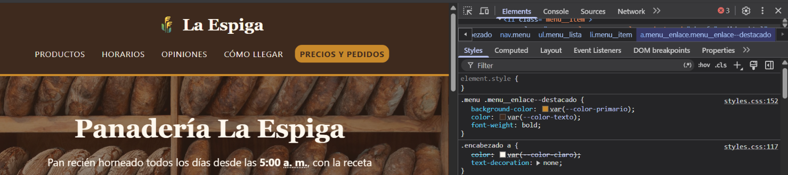

### Conflicto 2: el fondo de las opiniones

```
main > .seccion:nth-child(even)   → (0,2,1)   background-color: var(--color-suave)
#opiniones                        → (1,0,0)   background-color: var(--color-fondo)
```

La sección de opiniones es par, así que le tocaba la franja de color, pero yo quería que tuviera su propio fondo de harina. Gana `#opiniones` porque un ID le gana a cualquier cantidad de clases.

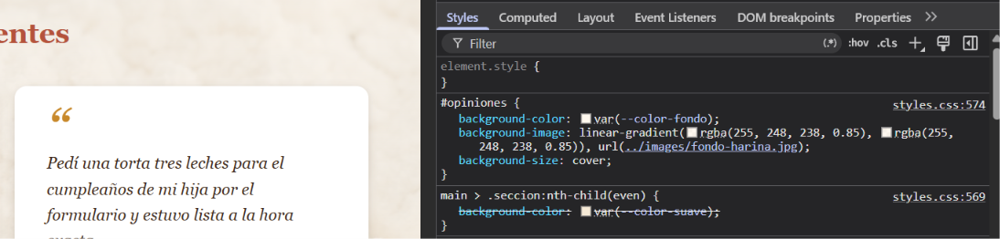

### Conflicto 3: el botón "Hacer otro pedido" (empate)

```
.boton               → (0,1,0)   background: var(--gradiente-marca);  color: var(--color-claro)
.boton--secundario   → (0,1,0)   background: transparent;              color: var(--color-primario-oscuro)
```

Las dos tienen una sola clase, así que empatan y gana la que está más abajo en el archivo. `.boton` está en la línea 201 y `.boton--secundario` en la 214, por eso el botón queda transparente. Si las cambiara de orden, los dos botones de `gracias.html` se verían iguales.

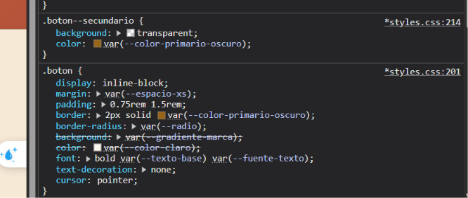

## 5. Herencia

El `color` y la `font-family` solo los puse en `body`, y aun así todo el texto los tiene. Por ejemplo, los horarios (`.lista__item`) no tienen ninguna regla de color y se ven en café oscuro, porque lo heredan de `body`.

El `border` no se hereda. La `.tarjeta` tiene borde, pero el título y el párrafo de adentro no. Si se heredara, cada cosa dentro de la tarjeta tendría su propio recuadro.

Algo que me pareció curioso es que los enlaces no heredan el color del padre, porque la regla `a { color: ... }` les aplica directamente y eso le gana a la herencia. En el pie quería que el teléfono fuera del mismo color crema del texto, así que tuve que forzarlo:

```css
.pie a {
  color: inherit;
}
```

## 6. Modelo de cajas

Calculé el ancho de una tarjeta de producto:

```css
.tarjeta {
  width: 13.5rem;                         /* 216 px */
  padding: var(--espacio-m);              /* 16 px */
  border: 1px solid var(--color-borde);
  margin: var(--espacio-s);               /* 8 px */
}
```

```
216 (contenido) + 16 + 16 (padding) + 1 + 1 (borde) = 250 px
250 + 8 + 8 (margen) = 266 px de espacio ocupado
```

El inspector muestra 250 px, no 216, porque el `width` es solo el contenido (`content-box`).

También tengo un caso de márgenes que se solapan. El título de cada sección tiene 16 px de margen abajo y el párrafo de introducción 16 px arriba. Pensé que habría 32 px entre los dos, pero en el inspector son 16: los márgenes verticales se juntan y queda el más grande, no la suma.

## 7. Selectores

Mi pseudoclase estructural es esta:

```css
main > .seccion:nth-child(even) {
  background-color: var(--color-suave);
}
```

`:nth-child` cuenta todos los hijos de `main`, tengan o no la clase `.seccion`, y después revisa si el elemento tiene la clase. En `index.html` la portada no tiene `.seccion` pero igual es el hijo número 1, entonces productos es el 2 (par, lleva franja), información es el 3, opiniones el 4 (par, pero gana `#opiniones`, ver conflicto 2) y ubicación el 5.

En la tabla uso `.precios tbody tr:nth-child(even) td`, que pinta las filas 2, 4 y 6. Las celdas de categoría son `th`, así que no cambian aunque estén en una de esas filas.

Otros selectores que usé: clases BEM (`.tarjeta`, `.tarjeta__precio`, `.tarjeta--promo`), el selector de atributo `a[target="_blank"]::after` que le pone una flechita a los enlaces que abren otra pestaña, `::before` para las comillas de las opiniones, `::marker` para el color de las viñetas, y `:hover`, `:focus-visible`, `:target` y `:focus-within` para la interacción.

## 8. Responsive

Tengo un solo `@media (max-width: 40rem)`. Lo que cambia en celular:

- Los títulos bajan de tamaño. Lo hice cambiando las variables `--texto-h1` y `--texto-h2` dentro del `@media`, y así se actualizan todos de una.
- El padding baja de 2rem a 1rem, porque en 360 px se perdía mucho espacio a los lados.
- Las tarjetas y las opiniones pasan a ocupar todo el ancho, una debajo de otra, y los horarios y los pasos también quedan en una sola columna.

La tabla de precios no cabe en 360 px. En vez de achicarla, la metí en un contenedor con `overflow-x: auto`, así se desliza de lado sin que se salga toda la página.

## 9. Problemas y soluciones

**La cuarta tarjeta se bajaba de línea.** Al principio las tarjetas tenían `width: 15rem`, y en escritorio quedaban tres arriba y la de galletas sola abajo. Haciendo la cuenta: 240 + 32 de padding + 2 de borde + 16 de margen = 290 px por tarjeta, o sea 1160 px las cuatro, y la sección solo tiene 1088 px de espacio (72rem menos el padding). Además, como son `inline-block`, los espacios del HTML entre una tarjeta y otra también ocupan un poquito. Lo arreglé bajando el ancho a `13.5rem`, que da 266 px por tarjeta y 1064 px las cuatro.

**Los campos del formulario se salían del recuadro.** En celular los `input` se pasaban por la derecha, y en escritorio el `select` se veía más angosto que los demás, aunque todos tenían `width: 100%`. Resulta que los `input` usan `content-box`, entonces al 100 % se le suman el padding y el borde, pero el `select` viene con `border-box` por defecto. Lo solucioné poniendo `box-sizing: border-box` en `.campo__control`, y ya todos miden lo mismo.

## 10. Capturas

### index.html

| Escritorio | Celular (360 px) |
|------------|------------------|
| 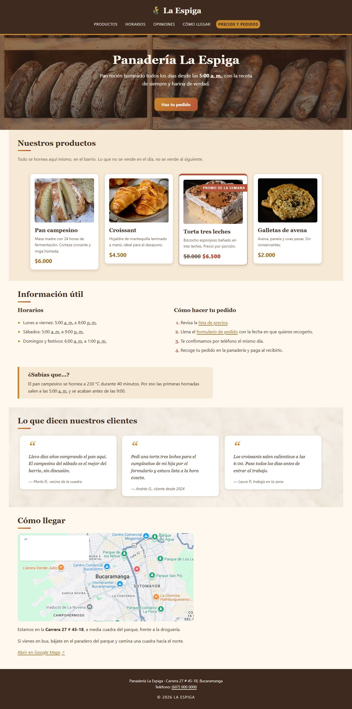 | 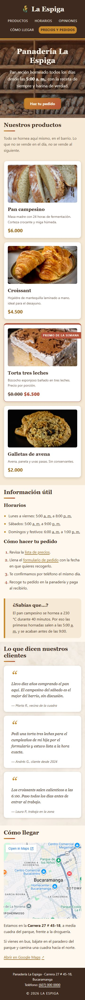 |

### pedidos.html

| Escritorio | Celular (360 px) |
|------------|------------------|
| 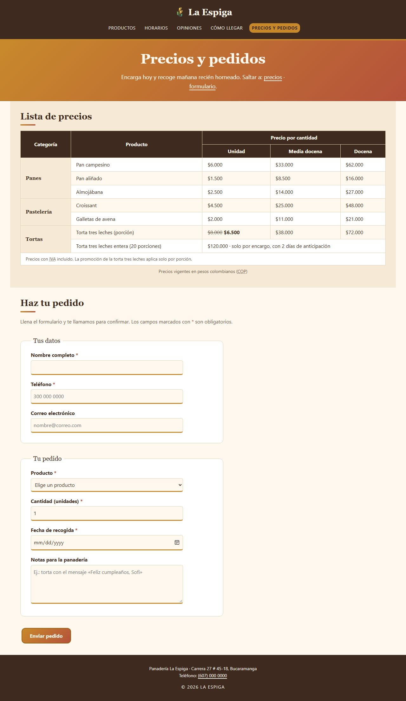 | 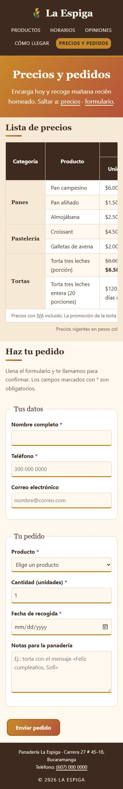 |

### gracias.html

| Escritorio | Celular (360 px) |
|------------|------------------|
| 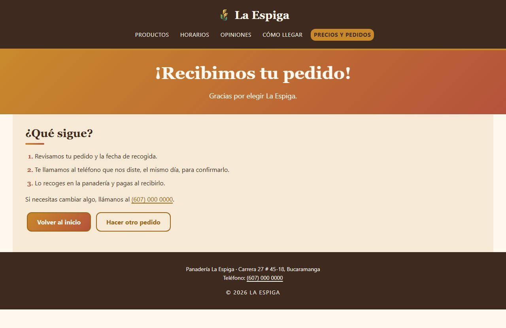 | 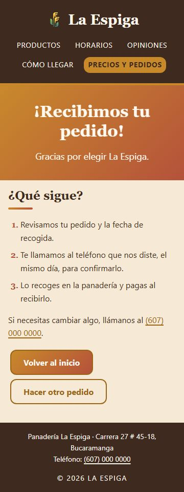 |

# Link para ver pagina
https://judatasgar.github.io/panaderia-la-espiga/
---
